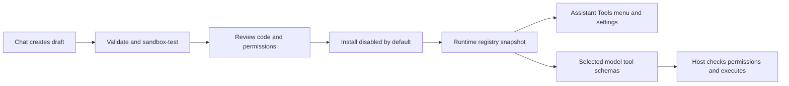

# Runtime tool plugins: future implementation plan

Status: **planning only**, 2026-10-19. I chose to plan this system now and implement it later. It is not part of the current built-in tool refactor, and there is no runtime plugin loader or chat-based installer yet. No release version is assigned. Recommendations below are proposals, not decisions I have already accepted.

## Goal and agreed direction

I want to ask the Assistant in Chat to build and add a tool, then use it in Chat or Voice without editing or rebuilding VoiceReader. I want each tool to own its settings and appear in the same Assistant-page Tools menu, with its own switch and the All tools control. The base app should remain small and optional runtimes should remain downloadable.

The current implementation is a useful first step: built-in Rust modules own schemas, handlers and timeout policy; frontend modules own settings; each side has an explicit available-tools list. That supports development-time extension. Installed plugins need a second registry populated from validated data at runtime. A Rust module added to source is not a runtime plugin.

## What the references demonstrate

[DeepSeek Harness](https://deepseek.com/en/harness/) presents a plugin-based assistant, including creating plugins through chat in Creator Mode. Its [official repository](https://github.com/deepseek-ai/deepseek-harness) uses Cordis. This validates the workflow I have in mind; adopting its complete application framework is a separate decision.

[Claude Mods](https://claude.com/resources/articles/claude-code-mods) allows creating extensions through conversation and hot-reloading them. Its [official overview](https://code.claude.com/docs/en/plugins/mods/overview) describes JavaScript/TypeScript event handlers, tools and UI extensions. Those mods run with broad access to the user's environment and are not sandboxed. That permission model is not an automatic consequence of wanting chat-created tools.

Sources read on 2026-10-19. Neither format is a promised compatibility target for VoiceReader. I want the creation/install experience; file format, runtime and permissions still need our own decision.

## Recommended first architecture (AI-recommended; not yet accepted)

Use a data-defined descriptor and settings schema, with execution through a host-owned adapter. Start by evaluating the existing optional WASI Python runtime for computation plugins. Add permitted web/API access through a host network broker only after its capability contract is settled. Do not require a full Node.js framework merely to reproduce the plugin workflow.

A merged registry would contain built-in descriptors and validated installed descriptors. Built-ins keep their Rust handlers; plugin handlers use a runtime adapter. The shared menu, schema builder, selection checks and result envelopes consume the registry. Runtime plugins must not supply arbitrary HTML or JavaScript to the webview.

The registry is immutable for a turn, like a model/version snapshot in an inference pipeline. Installing or updating a tool affects later turns. Explicit revocation is different: disabling a capability or uninstalling its plugin should cancel/drain its active work before removal. We must decide how this interacts with the current built-in switches, which apply to the next turn.

## Proposed package contract

Store a plugin under the app's data directory, for example `assistant/plugins/<plugin-id>/<version>/`. A package contains a manifest, entry script, optional bounded read-only resources and an installation receipt. This layout is illustrative, not a finalized filesystem/API contract.

A versioned manifest should describe:

| Field | Purpose |
|---|---|
| Format version, plugin ID, version and compatibility | Reject unsupported packages; avoid replacing built-ins or another publisher's namespace. |
| Display name, description and tool input schema | Render the menu and expose validated function definitions to the model. |
| Settings schema | Field types, labels, defaults, required values and secret-reference fields, rendered by the host. |
| Runtime and entry point | Choose a supported adapter; never an arbitrary host shell command. |
| Requested permissions | Declare allowed network/API, resource or other capabilities for review. |
| Resource limits | Bounded runtime, output, memory and package/resource sizes, subject to host maximums. |
| Provenance and content hashes | Record what was reviewed and installed; detect changed code or resources. |

Start with one plugin exposing one tool unless a concrete use case requires multi-tool packages. Tool names must be stable, collision-free and valid for the supported model backends. Validate IDs, schema size/depth, arguments, entry paths, resources, versions and unknown fields/permissions before loading. Reject path traversal, escaping symlinks, name collisions and unrecognized capabilities. Discovery must have no executable import/startup side effects.

Settings use a separate per-plugin namespace and version/migration policy. A generic host renderer should initially support a small set of text, number, boolean, enum and credential-reference fields. A weather plugin could expose a timeout; a search plugin could expose its provider and key reference. Code changes must not be required for those ordinary fields. Dynamic custom UI is outside the first recommendation.

## Execution options and the decision still needed

| Option | Benefit | Main cost or limit |
|---|---|---|
| Existing optional WASI Python + host capability APIs | Reuses the runtime download and current isolation/cancellation model. | Standard library only today; network broker and plugin invocation protocol still need implementation. |
| Trusted local Python/JavaScript processes | Wider libraries and ecosystem compatibility. | Dependency management, larger downloads and substantially broader access; process separation alone is not a sandbox. |
| WASM plugin interface or external protocol such as MCP | Explicit host boundary or compatibility with external servers. | New SDK/adapter and lifecycle work; external servers need their own installation and permission model. |

My current recommendation is to prototype a pure-computation plugin through WASI first, then a narrowly permitted API plugin. This is **AI-recommended**. I have not yet selected the first plugin capability set. We should settle that before committing to the runtime or package contract.

For API plugins, a proposed host broker would enforce explicit destinations, HTTP methods, credentials, request/response sizes, timeouts and cancellation. Reuse the existing public-address/DNS/redirect/proxy protections, and check every destination and redirect against the plugin's approved permissions. Do not give guest code raw sockets, host environment variables or unrelated files. Tool output remains untrusted model context.

Credential references must be resolved by the host for the authorized operation. Never put secret values in the manifest, model prompt, tool result or installation transcript. The current built-in Brave key uses disclosed plain-text settings storage; the credential store for new plugins remains an open decision, including an OS credential store versus compatible app storage.

## Creating and installing a tool through Chat

1. I describe the tool. The Assistant proposes its purpose, inputs, settings and permissions before generating a draft package in an isolated staging area.
2. The host validates the manifest and code/package boundaries, then runs bounded tests in the selected sandbox with synthetic inputs and permitted test resources. Code generation is not permission to install or run unrestricted code.
3. I review a concrete summary, source, requested permissions and test results. The model cannot approve its own generated package or grant capabilities on my behalf. The precise approval UX remains to be designed.
4. Installation verifies the reviewed content hashes and atomically activates the new package record, initially disabled. The menu discovers it without an app rebuild; I choose Chat/Voice enablement independently.
5. Invocation validates model arguments, settings and current grants, executes with limits and emits the existing tool activity/result/source events. Stop cancels the entire turn and plugin work.

This is a proposed workflow, not an implementation. Chat authoring should use dedicated host operations to stage, validate, test and request installation. It must not gain arbitrary write access to the app source or active plugin directory.

## Updates, removal and recovery

Updates are staged and tested beside the active version. Changed code or permissions require a new review; an existing grant does not silently authorize expanded permissions. Keep a last-known-good version and an installation receipt for rollback. Remove settings/credentials only according to an explicit retention choice; uninstalling code and deleting credentials are different operations.

Settle concurrency before implementing hot reload: registry snapshots, active-operation leases, cancellation/drain on revocation, cross-window discovery and an atomic activation record. Never replace files under an executing interpreter. Invalid or partially installed plugins should be quarantined with a readable error, while other tools and normal Chat keep working.

## Suggested implementation phases (not scheduled)

1. **Contract prototype:** decide runtime/capabilities; validate a manifest and load one hand-authored computation plugin, disabled by default. Prove discovery, selection, execution, Stop and restart persistence without source changes.
2. **Settings and lifecycle:** generic settings UI/storage, namespacing, versioning, installation receipts, staged updates, rollback and removal.
3. **Permitted API access:** broker, credential references, destination/method grants and failure handling; test a small real API tool.
4. **Chat authoring:** generate draft packages, validate/test, review/install flow and human-readable diagnostics. Reuse the same installer as manual import.
5. **Packaging experience:** import/export and update prompts; decide whether a registry/catalogue or distribution signing is needed from actual usage.

Each phase needs positive and negative tests: malformed/oversized manifests, traversal/symlinks, collisions, incompatible versions, unknown permissions, denied API destinations, secret redaction, timeouts, Stop, update during a turn, permission revocation, concurrent windows, partial installs and rollback. A valid schema is not proof that generated code behaves correctly; tests and constrained capabilities serve different purposes.

## Decisions to revisit before implementation

- Which first real plugins require computation, public APIs, local files or system actions? I deferred this answer while planning.
- Is WASI Python sufficient, or do actual plugin requirements justify a second optional runtime?
- What exact permissions can be granted, how are credentials stored, and what requires renewed approval?
- Are plugins tools/settings only, or is there a demonstrated need for custom UI/event hooks?
- What package compatibility/version policy, distribution trust model and cross-platform support do we promise?

These choices should be settled with a small executable prototype and real use cases. The current built-in module refactor deliberately does not claim to answer them.
