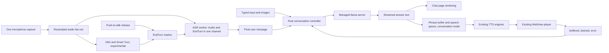

# VoiceReader v0.3.0 Assistant Plan

Updated: 2026-10-19. **Steps 1–5 are committed in `5e62732`**, together with the page redesign and model management. I have tested the Assistant working on macOS. Windows compilation/runtime and the known remaining Assistant gaps are deferred until I can test on Windows. The [tools phase](v0.3.0_tools_plan.md) is also implemented; [assistant/tools.md](assistant/tools.md) records its current contracts and validation. I have accepted the current Assistant/tools and UI on macOS. Optional tools and Voice thinking extend the original scope below. The version is now `0.3.0`, in release preparation; Windows remains pending.

This document brings together my initial discussion, the two reference projects, the direction I chose on 2026-10-14, the Opus 5.5 review and source checks, and the grilling review on 2026-10-18 (section 11). Decisions marked *(AI-recommended)* were accepted on the reviewer's recommendation rather than proposed by me; they deserve a second look before or during implementation. Facts marked "checked" were confirmed from source code, upstream build scripts or the Hugging Face API on 2026-10-18; items in section 9.2 still need confirming by running them.

## 1. Direction and audience

VoiceReader is a free tool I build in my spare time and pass to friends and family. The Assistant's infrastructure should be sized for that: simple, reliable pieces rather than the update, signing and variant machinery a public product would need.

I want an optional personal assistant for questions and voice conversation. It is a Rust conversation controller that reuses VoiceReader's microphone capture, ASR, TTS engines and player. The Pipecat project is a reference for conversation behaviour; I am not shipping its Python stack.

The Assistant is **Base build only**. The Full build is deprecated but its code stays in the repository in case I explore it again; it shows no Assistant page, and all focus is on the Base build.

llama.cpp is included in the optional Assistant download and managed by VoiceReader. Installing the Assistant installs its local backend too; nobody should have to find llama.cpp, use a terminal or start a server manually. The backend version is pinned to each VoiceReader release (section 4).

The base app stays small and the Assistant optional. Having ASR, a model and TTS completes the basic chain, but turn boundaries, resource ownership and the response lifecycle still need engineering and validation, and having all three components does not establish acceptable combined latency.

## 2. v0.3.0 scope

| In v0.3.0 | Out of v0.3.0 |
|---|---|
| Chat page: typed or push-to-talk input, streamed Markdown answers, thinking toggle, per-message Speak, image attachments | External API provider UI; only a hidden developer base-URL setting for my own testing *(AI-recommended)* |
| Conversation mode: push-to-talk voice in, voice out, transcript side pane, interrupt by pressing the button | Saved chat history; conversations live in memory only *(AI-recommended)* |
| Experimental auto-send (VAD + Smart Turn) in conversation mode | Custom Hugging Face models; one curated catalogue only *(AI-recommended)* |
| App-managed llama.cpp, pinned per release, Vulkan on Windows and Metal on macOS | Backend updates independent of VoiceReader releases; CUDA builds |
| Four curated models with hardware-based recommendation (catalogue review in §5.1) | Global push-to-talk hotkey; the on-page button only |
| Load/Unload controls and a context-length setting with memory warnings | Always listening, wake words, voice barge-in (needs echo cancellation) |
| Optional web search, page reading, weather, WASI Python and Voice thinking (tools-phase extension) | Images in conversation mode; file/app actions; persistent personal memory; runtime plugins |
| | Running the Assistant and Transcribe at the same time; Full build support |

## 3. User experience

### 3.1 Assistant page and model lifecycle

- Opening the Assistant page starts llama-server so model loading overlaps with the user typing or speaking. Ordinary app startup never starts the server or listens to the microphone.
- The page shows "Loading model…" while llama.cpp's `/health` endpoint reports loading, and the active device (Vulkan GPU, Metal or CPU) once ready.
- Explicit **Load** and **Unload** buttons let the user free memory and reload. The server also unloads after about 10 minutes idle and when the Assistant is turned off *(AI-recommended)*.
- A gear icon opens model settings, including context length. A changed setting applies on the next load and shows a memory warning (section 5.3).
- Only one model is loaded at a time; switching tiers restarts the server.

### 3.2 Chat page

- Input by typing, or by holding/toggling the push-to-talk button for voice input.
- Answers stream as text with Markdown rendering under a strict safety rule: **model output never becomes HTML** *(AI-recommended, from Codex F4)*. The WebView can invoke desktop commands (for example `save_text_file` writes any path it is given) and the app has no CSP (`tauri.conf.json` `"csp": null`), so HTML from a model echoing hostile pasted content could run as privileged script. The renderer builds DOM nodes with `textContent` for a Markdown subset (paragraphs, headings, emphasis, inline and fenced code, lists, block quotes, links). Raw HTML in the output appears as literal text. Markdown images are never fetched. Links open only for `http`/`https`, in the default browser through the shell-open API, never inside the WebView. Tightening the app-wide CSP is a separate follow-up because it can break existing pages.
- A **Stop** button cancels a streaming answer. The text received so far stays in the conversation, marked as stopped.
- Each message has a **Speak** button that uses the existing normal read-aloud; answers are not spoken automatically *(AI-recommended)*. The chat page therefore does not depend on the streamed speech queue.
- A **Think** toggle, **on by default**: in chat the expectation is better answers rather than a quick reply. Reasoning appears in a collapsed "Thinking…" section above the answer, is never passed to Speak, and is removed from the history sent back to the model (section 5.4).
- Images can be attached by button, paste or drag-and-drop, up to 4 per message. The app downscales them before sending, to at most 1024 px on the long edge, to bound image tokens and memory. Images live only as long as the conversation; "New chat" clears them. Speak reads text only *(AI-recommended)*.
- "New chat" resets the conversation; closing the page discards it.

### 3.3 Conversation mode

- Speech is the input and voice is the output. A side pane shows the transcript of both the user and the assistant.
- Push-to-talk is the turn boundary: hold or toggle the button, and releasing it sends. While the assistant speaks the microphone stays closed. Pressing the button during an answer cancels the answer and starts listening. Because the interruption is an explicit button press, no echo cancellation or speech detection is needed for it *(AI-recommended)*.
- Reasoning is off by default for conversation mode. The subsequent tools phase adds an optional Voice Think toggle and independent thinking budget; see [the tools plan](v0.3.0_tools_plan.md).
- A toggle, "Send automatically when I stop talking (experimental)", replaces the button release with VAD + Smart Turn (section 7.4). It is on in my own builds and off by default for friends and family until it stops cutting people off mid-sentence. When auto-send fires, the final transcript is shown so false cut-offs are visible. Push-to-talk remains the fallback and the comparison baseline *(AI-recommended)*.

## 4. Backend delivery (llama.cpp)

### 4.1 Pinned per release

Each VoiceReader release compiles in one llama.cpp build tag, its upstream GitHub asset URL and its SHA-256. The app downloads over HTTPS, verifies the hash and installs. Upgrading llama.cpp means shipping a VoiceReader release, which I already do. Because the expected hash lives in the app binary, the app binary is the trust root: anyone able to change the hash could already change the app. No catalogue, signing key, rollback or update channel is needed for v0.3.0 *(AI-recommended)*.

Checked upstream release facts (build `b11718`, 2026-10-18):

- GitHub's "latest" release currently points to `v0.7.0`, which contains only `nightly-tag.txt`. The real builds are tagged `bNNNN`, several per day, all marked prerelease. Selecting "latest" and matching asset names, as the image caption editor does, no longer finds a backend. Pin an explicit `bNNNN` tag.
- macOS assets are now `.tar.gz`, not `.zip`.
- Asset sizes: Windows Vulkan x64 32.3 MB, Windows CPU x64 19.7 MB, macOS arm64 12.3 MB. CUDA needs about 580–660 MB once the `cudart` runtime zip is added.

### 4.2 One package per OS

| Platform | Asset | Device selection |
|---|---|---|
| Windows x64 | `llama-<tag>-bin-win-vulkan-x64.zip` | Vulkan on NVIDIA/AMD/Intel GPUs, CPU otherwise |
| macOS arm64 | `llama-<tag>-bin-macos-arm64.tar.gz` | Metal (embedded), CPU fallback |

The upstream release workflow builds only `ggml-vulkan.dll` for the Vulkan job and injects `llama-server` and the CPU backends from the Windows CPU build, which uses `GGML_BACKEND_DL` and `GGML_CPU_ALL_VARIANTS`. llama.cpp therefore loads whichever backends work at runtime, so "the app decides the backend" is largely llama.cpp deciding. The app reads the chosen device from `--list-devices` or the startup log and shows it. This is checked from the build scripts only; the CPU fallback must be confirmed by running (section 9.2).

CUDA is skipped: it is about 20× larger and adds an install path to test. It is not a blocker until speed for larger models needs optimising, and can be added later as an opt-in "faster on NVIDIA" download. A side benefit: my RTX 5090 runs the same Vulkan path users will.

### 4.3 Installation

1. Show the required downloads and disk space before starting.
2. Download into a staging directory, with cancellation.
3. Verify SHA-256, then extract the complete set. On macOS, extraction must preserve symlinks (the archive contains dylib symlinks) and executable permissions.
4. Rename the staging directory into its versioned install directory. A partial download never appears as an installed backend.
5. Include the upstream MIT licence notice.

This optional package is separate from the deprecated Full build's Python TTS sidecar.

### 4.4 Process lifecycle

- Bind to `127.0.0.1` on a free port and require an app-generated API key, matching the existing sidecar's token pattern (`voicereader_core.rs:3019`).
- "Process spawned" is not "ready to answer": wait for `/health` to report ready, and surface loading separately.
- Capture logs, detect process exit and shut down on app exit (`RunEvent::ExitRequested`, as for the existing sidecar).
- **Orphan cleanup** *(AI-recommended; refined by Codex F5)*: on launch, write a run record in the backend directory holding the server's PID, its executable path, its start time and the **owning VoiceReader process's PID**. On the next start, stop a recorded server only when its owner is no longer running and the PID still belongs to our llama-server executable. If the owner is alive, another VoiceReader instance is using the Assistant: this instance does not stop it and does not start a second server, and its Assistant page says the Assistant is in use in another VoiceReader window. Nothing currently enforces a single app instance, so this check is what prevents one launch from killing another's healthy server. On Windows, also assign the child to a Job Object with `KILL_ON_JOB_CLOSE` so Windows ends it if the app dies. The existing sidecar currently relies on graceful shutdown only; the same cleanup can later protect it.
- Server flags of note: `-c` from the context setting, `--mmproj` for the tier's projector, `--no-reasoning-preserve`. `--fit` is on by default (section 5.3).

### 4.5 Deferred: independent backend updates

Updates independent of VoiceReader releases are deferred until there is real demand. If they return, the earlier review point still applies: a file hash proves bytes match a catalogue entry, not who authorised the entry, so a downloaded catalogue would need its own trust root (for example a signature checked against a key in the app). The versioned install directories above keep that option open without changing the layout.

## 5. Models and memory

### 5.1 Curated catalogue

The current four-model catalogue uses Q4 quants: Unsloth's `UD-Q4_K_XL` where available, otherwise `Q4_K_M`. Each downloads an F16 mmproj (vision projector) for image input. The original three-model selection was reviewed during planning; the later MiMo addition has its own model/licence terms. Check each linked repository card rather than assuming a common model licence.

| Tier | Repository | Weights | mmproj | Download total | Intended machines |
|---|---|---|---|---|---|
| Small | [openbmb/MiniCPM-V-4.7-1B-gguf](https://huggingface.co/openbmb/MiniCPM-V-4.7-1B-gguf) | `Q4_K_M` 0.67 GB (no UD quant) | `mmproj-model-f16.gguf` 1.11 GB | 1.8 GB | Weaker machines |
| Mid | [unsloth/gemma-4-E4B-it-GGUF](https://huggingface.co/unsloth/gemma-4-E4B-it-GGUF) | `UD-Q4_K_XL` 5.13 GB | `mmproj-F16.gguf` 0.99 GB (includes the audio encoder) | 6.1 GB | 16–32 GB RAM with integrated or 4–6 GB graphics, or Macs |
| Mid-high (added 2026-10-19) | [bartowski/MiMo-V2.6-Distill-Qwen-9B-GGUF](https://huggingface.co/bartowski/MiMo-V2.6-Distill-Qwen-9B-GGUF) | `Q4_K_M` 5.84 GB (no UD quant) | `mmproj-…-f16.gguf` 0.92 GB | 6.8 GB | Xiaomi's agentic fine-tune of Qwen3.5-9B (MIT), trained for tool use; the candidate for tool calling |
| Large | [unsloth/gemma-4-12b-it-GGUF](https://huggingface.co/unsloth/gemma-4-12b-it-GGUF) | `UD-Q4_K_XL` 7.37 GB | `mmproj-F16.gguf` 0.18 GB | 7.5 GB | Stronger machines |

**Catalogue review (2026-10-19): four models, Bonsai deferred.** The catalogue is MiniCPM-V 4.7 1B, Gemma 4 E4B, MiMo-V2.6 9B and Gemma 4 12B. The goals are good tool calling, image input and speed (voice mode runs speech recognition, the model and TTS together). Prism ML's Ternary Bonsai 2 (2B, 4B, 27B; Apache-2.0, Qwen3.5/3.8 hybrids with vision) was considered for CPU-only machines and dropped for now. Its fast `PQ2_0`/`PTQ1_0` files need Prism's llama.cpp fork, and its own known-issues page lists, for the current binary releases: `PQ2_0` on Vulkan silently running on the CPU at under 2 tokens/s, slow or hanging `PTQ1_0` on Vulkan (Intel Arc), the fast x86 CPU kernels not yet released, a load crash on AVX-512 CPUs including Zen 4/5, 3,000+ thinking tokens on simple prompts, and malformed or looping tool calls on the 27B. Ternary weights mainly speed up decoding (memory-bound); prefill is compute-bound and scales with parameter count, so they would not fix long-context prefill. Revisit when the formats reach upstream llama.cpp. Gemma 4 12B stays until it is benchmarked against MiMo (prefill at 4K/16K/32K and decode).

Sizes exclude the KV cache and compute buffers. MiniCPM also offers `mmproj-model-f16-4x.gguf` for its finer-detail 4x visual-token mode; the standard projector goes in the catalogue and the `-4x` file is checked during the image work.

**Pin model files as well as the backend.** Each catalogue entry records the Hugging Face commit revision and the SHA-256 of every file, and downloads by that revision rather than `main`. Model repositories are re-uploaded (Unsloth's Gemma 4 card notes a re-download for chat-template and llama.cpp fixes), so downloading from `main` could change what users receive without a VoiceReader release. Model downloads use the same staging, verification and rename steps as the backend.

### 5.2 Tier recommendation

The app recommends a tier from detected hardware and never downloads several GB automatically; the user chooses *(AI-recommended)*.

- **Large**: a dedicated GPU with ≥ 12 GB video memory, or a Mac with ≥ 32 GB.
- **Mid**: a Mac with ≥ 16 GB, or a PC with ≥ 16 GB RAM, subject to the memory rule below.
- **Small**: everything else.
- For integrated GPUs, judge by system RAM, not the "video memory" Vulkan reports, which is shared system memory and makes weak machines look capable *(AI-recommended)*.
- My family member's RTX 4090 / 64 GB DDR5 machine is the test machine for the large tier.

### 5.3 Memory rule, context length and warnings

One rule drives both the tier recommendation and the out-of-memory warning *(AI-recommended)*:

- **Unified memory (Mac) or CPU-only:** everything the Assistant adds stays within 50% of system RAM, with ASR and TTS also loaded.
- **Discrete GPU:** model, projector and KV cache fit in video memory with a 1 GB margin, matching `--fit`'s default; system RAM covers anything that spills.

Default context length is **32K** for every tier; 8K is too little for useful answers once thinking is enabled. The gear setting can raise or lower it, applied on the next load.

KIV: I intend to make **128K** the default on most machines. The small model is light and most new machines have 16 GB of RAM, so this would make the Assistant much more useful. It is deferred because it is easy to change later. Before switching, check each tier's trained context limit and the measured memory slope below, and measure prompt-processing time on long contexts on CPU.

Memory estimate *(AI-recommended; refined by Codex F3)*: memory is roughly linear in context, `pool ≈ fixed + per_token × ctx`, but there are **two pools**. On a discrete GPU, model, KV and compute buffers split between video memory and host RAM, and one resident-memory number cannot say which limit is hit. So for each catalogue model, record llama-server's own per-device buffer report (model, KV cache and compute buffers for each device, printed at startup) at two context sizes, and store `fixed` and `per_token` separately for the GPU pool and the host pool. Projector and image-processing buffers are measured with an image request.

The checks then compare the right numbers:

- **Host RAM:** the host pool plus the other VoiceReader models loaded at the time (ASR takes about 1.3 GB when loaded, plus the active TTS model) stays within 50% of system RAM on unified-memory and CPU-only machines.
- **Video memory:** the GPU pool stays within video memory minus 1 GB on discrete GPUs.

The gear dialog compares these estimates with the detected hardware and shows:

- ✅ fits
- ⚠️ will spill to CPU (slower), on discrete GPUs
- ⛔ may exhaust system RAM (crash or heavy swapping)

If a load fails, fall back to the last context size that worked and say why *(AI-recommended)*.

Checked behaviour of `--fit` (default `on`, 1024 MiB margin): it only adjusts arguments that were not set. With an explicit `-c`, it keeps the context and moves layers off the GPU instead. On a discrete GPU, a shortage usually makes the model slow rather than crashing it; real crash or swap risk comes from system RAM on CPU-only machines and Macs.

Open measurement: E4B is 6.1 GB before its KV cache. Whether E4B at 32K fits the 50% rule on a 16 GB Mac is measured, not assumed; if it does not, 16 GB machines are recommended the small tier or a smaller context.

### 5.4 Thinking and reasoning history

All three models switch thinking via `enable_thinking` in their chat templates. The pinned llama.cpp server also accepts per-request `reasoning_effort` (`none` disables thinking) and a `--reasoning-budget`.

- Conversation mode: `reasoning_effort: none` on every request.
- Chat page: the template default when Think is on, `none` when off.
- One server serves both modes without restarting.
- Earlier turns' reasoning is **removed from history**: only earlier answers are sent back to the model. Use `--no-reasoning-preserve` and omit `reasoning_content` when the client builds the history *(AI-recommended)*. Old reasoning is the biggest consumer of context when thinking is on.

The catalogue records each model's thinking control. So far it is the same boolean for every tier.

## 6. Conversation controller

The controller owns the conversation, the active response ID and cancellation. Its states distinguish model loading, ready, listening, finalizing transcription, generating, speaking, stopped and error. Generation and speaking overlap; a strictly sequential state machine must not prevent that. Text generation complete, speech synthesis complete and audio playback complete are three different events.

The controller talks to llama-server's OpenAI-compatible chat endpoint. The hidden developer base-URL setting reuses the same client for my own testing; native provider protocols and stored API keys are out of scope.

### 6.1 Playback feedback contract

*(AI-recommended)* The WebView player keeps its audio queue but reports to Rust per response:

- `buffered(response_id, seconds_queued)` about every 250 ms, for backpressure only
- `phrase_played(response_id, phrase_seq)` when the last sample of a phrase has been consumed
- `drained(response_id)` when the last sample of the response has played
- `error(response_id)`

Every PCM chunk Rust sends carries its `phrase_seq`. Rust records which phrases were heard only from `phrase_played` acknowledgements, never by subtracting queue depth from what it submitted. A queue depth of zero cannot tell "phrase A finished" from "phrase B has not reached the player yet", because the player enqueues asynchronously *(AI-recommended, from Codex F8)*.

Rust ignores events for a superseded response ID or playback epoch. Rust stops synthesising ahead when `seconds_queued` exceeds a cap (8 s to start), which is the backpressure.

The watchdog is a **stall detector, not a total-duration deadline** *(AI-recommended, from Codex F9)*. It fails playback only when audio is queued, playback is not paused, and consumed samples have not advanced for 5 s. An empty queue while the model is still producing text is a normal generation gap, and a user pause or speed change is not a stall. After the text is finished and the queue is empty, `drained` must arrive within a few seconds. A failure returns the conversation to a usable state rather than leaving it stuck. Auto-send reopens the microphone only after `drained`; using synthesis completion instead would let the assistant transcribe itself.

Consumed samples estimate delivered playback. They do not prove the person heard the answer and do not give word boundaries.

### 6.2 Preemption

A new explicit read-aloud action (Speak or the read-selection hotkey) **ends** a conversation-mode response, matching v0.2.2's "hotkey replaces playback" rule. The rule is about who owns audio. A chat-page answer streams as text and owns no audio, so read-aloud during it (including its own Speak button) starts speaking without cancelling the text stream *(AI-recommended, from Codex F2)*. For a conversation-mode response, cancellation reaches the LLM request, pending text, synthesis and queued audio, and the conversation records the turn as interrupted. To make this possible, the Assistant must not hold the shared TTS runtime lock while waiting for model text. It holds the lock for one bounded synthesis job at a time and releases it between phrases.

### 6.3 Context handling and interruptions

- Keep the system prompt and as many recent turns as fit; drop the oldest turn pairs first.
- **Room for the answer and oversized messages** *(AI-recommended, from Codex F1)*: before each request, count the prompt's tokens with llama-server's `/apply-template` and `/tokenize` endpoints, adding a per-model estimate for each attached image. Reserve room for the answer: 2,048 tokens with Think off and 8,192 with Think on, capped at a quarter of the context. Evict the oldest turn pairs, images included, until prompt plus reserve fits. If the current message alone cannot fit, refuse it before sending and say so: the message's token count, the limit, and that it can be shortened or the context length raised in the gear settings.
- **Interrupted answers depend on the mode** *(AI-recommended; split by Codex F2)*:
  - Conversation mode: the answer is stored up to the last phrase confirmed by `phrase_played`, followed by `[interrupted by user]`. Precision is per phrase, not per word. Unspoken text is discarded so the model never assumes the user heard it.
  - Chat page: the user has read the text, so everything received before Stop is kept, followed by `[stopped by user]`.
- No history persists after the page closes.

## 7. Speech input: ASR, push-to-talk and auto-send

### 7.1 Microphone and ASR ownership

The current app permits one ASR job at a time, including reference-clip transcription. The microphone source has one receiving consumer and stays on the thread that opened it. The Assistant uses one capture path that fans the same resampled audio out to ASR and, when auto-send is on, to VAD and Smart Turn.

The Assistant and Transcribe are mutually exclusive in v0.3.0:

- Starting the Assistant while Transcribe is recording shows "Transcription in progress". It never stops the recording, because silently ending a meeting recording loses data.
- Starting Transcribe or reference-clip transcription while the Assistant is active ends the Assistant session, which only costs conversation state *(AI-recommended)*.

### 7.2 Turn ordering in the ASR worker

*(AI-recommended)* Control messages travel in the same channel as audio: `Audio(samples)`, `EndTurn(turn_id)`, then the next `Audio`. The ASR worker processes them strictly in order. On `EndTurn` it releases trailing words with the existing silence-padding flush, emits the final transcript and calls `reset()`. Audio for the next turn waits in the queue behind it, so nothing is dropped or blended into the previous turn, and no lock is needed. This handles a quick second push-to-talk press and speech resuming during auto-send finalization.

**The capture stage produces `EndTurn`, not the button** *(AI-recommended, from Codex F6)*. Microphone blocks pass through a separate capture queue and a resampler (`audio_capture.rs`) before reaching ASR. If the button release went straight into the ASR channel, a final block still in the capture queue would arrive after `EndTurn` and count toward the next turn. So a release is a message to the capture thread. It forwards every block captured before the release, flushes the resampler tail, and only then sends `EndTurn`. A single producer writing the boundary into the stream is what keeps FIFO order equal to recording order.

**Admitting finished transcripts** (implemented in Step 2, from Codex F7). If a new turn starts while an older turn is still finalizing, there is no answer yet to interrupt. When the older transcript arrives during the newer recording, it is held and joined with the newer turn into a single user message when that turn ends. Starting a new turn cancels any answer already in progress. The model then never answers half a thought, and an answer is never spoken into an open microphone.

Existing ASR facts:

- The ASR is English-only, processes 1.12-second chunks and can emit words after they were spoken. Its transcript display turns and speaker-hold settings are not conversation-completion signals.
- The recording-end path pads the last chunk and feeds three chunks of synthetic silence to release trailing words. Push-to-talk pays this flush cost on every release.
- The vendored `MultitalkerASR` has an utterance `reset()`. The Assistant worker now provides the application-level turn flush/reset session around it; this was a prerequisite when planning Step 2.
- Keep ASR loaded while the Assistant is active rather than paying model-loading cost per turn.

### 7.3 ASR experiment

Use one loaded model and utterances A and B, sent through the worker above:

- continuous transcription
- `EndTurn` after A, then B
- B arriving while A is being finalized

Check trailing words, duplicated or missing submissions, state leakage and the time from release to final transcript, on the constrained profile (section 9.1). Synthetic silence duration is not the same as compute wall time; measure rather than extrapolate. Opus's concern that resumed speech degrades after a flush remains an unverified hypothesis.

### 7.4 Auto-send experiment (VAD + Smart Turn)

VAD identifies speech and pauses; Smart Turn evaluates whether a pause likely ends the turn. Silence alone must not send an unfinished thought. When the experiment decides the turn is over, it emits the same `EndTurn` marker as a button release.

- The upstream Smart Turn v3 model card lists an approximately 8 MB int8 ONNX checkpoint. Reproduce its required resampling, feature extraction, padding and windowing in Rust, and compare predictions with the [upstream reference inference](https://github.com/pipecat-ai/smart-turn/blob/main/inference.py) before tuning timings. Start with CPU inference through the existing ONNX Runtime; running through ORT does not remove the preprocessing work.
- Do not copy the Pipecat example's 50 ms transcript aggregation timeout; it was configured for a different Whisper service.
- Evaluate complete questions, mid-sentence pauses, hesitation, trailing words, silence, background noise and speech resuming during endpoint analysis. Measure prediction agreement, false cut-offs, end-of-speech-to-final-transcript latency and extra memory, compared against push-to-talk.

## 8. Streamed speech output (conversation mode)

Normal read-aloud keeps its existing behaviour: a new request replaces the current job. Conversation mode needs an appendable response stream. These are distinct scheduling policies over shared TTS generation and playback components.

Internal operations (not committed command names):

- **Begin response**: create its ID and capture voice/TTS settings.
- **Append text**: accept ordered answer text from the LLM stream.
- **Finish text**: flush the final phrase and close input; let audio finish playing.
- **Cancel response**: abort the LLM request, discard unspoken text, cancel synthesis and clear queued audio.

### 8.1 Speakable text

*(AI-recommended)* Fix formatting at the source. The conversation-mode system prompt asks for short spoken sentences with no Markdown, lists or code, and reasoning is off (section 5.4). A small final filter strips `*`, `#` and backticks, skips fenced code blocks and drops anything inside `<think>` tags. There is no full streaming Markdown-to-speech normalizer. The chat page keeps normal Markdown because it is for reading.

### 8.2 Phrase buffer and queue

- Display incoming text immediately, but speak complete sentences or sensible clauses rather than tokens. Use bounded waiting and length limits for long sentences, and handle abbreviations, numbers and partial words. Committed phrases are never revised and spoken twice.
- Reuse engine selection, voices, voice-state caching, normalization/chunking where appropriate, PCM events, volume and speed controls. The current normalizer expects completed text, so check how it handles incomplete streamed text and line breaks.
- One response owns the audio stream across all phrases. Do not emit whole-response completion or reset playback at each sentence boundary. Preserve output order, bound pending text and audio (section 6.1), and ignore late events from a cancelled response.
- The existing engine interfaces accept completed text. Reusable lower-level synthesis operations and response-level scheduling need refactoring rather than calling `speak_text` repeatedly.
- Immediate playback stop and immediate computation stop are different guarantees. Kyutai generation can finish work already running before its cancellation checks take effect. Ignore stale output, stop submitting work and bound in-flight generation, rather than promising every engine aborts mid-call.

### 8.3 Buffering when model text arrives slowly

The existing player treats gaps within an open job as underruns. Its refill threshold grows to one second after the first gap and two seconds after the second. A source-level state simulation confirmed that at 1x, a complete 1.5-second phrase after the second gap stays queued while input is still open.

Conversation answers naturally pause while the LLM produces the next phrase. Add a conversation-specific buffering policy or a phrase-ready signal over the shared player, and keep normal read-aloud's policy unchanged. Test slow and bursty text, final short phrases, multiple gaps and 2x playback. Do not reset the whole response per sentence to bypass the threshold.

## 9. Testing and acceptance

### 9.1 Hardware and measurements

I have no access to weak target devices; my machines are an M2 Max with 96 GB and a Ryzen 9 9950X with an RTX 5090. Speed measured on them says little about users' machines, but memory transfers across machines. Therefore *(AI-recommended)*:

- **Memory is the gate**: the rule in section 5.3, measured with ASR and TTS loaded.
- **Latency is tracked, not gated**, on a constrained profile: Windows on Vulkan or CPU (never CUDA), `-t 4`, the small or mid model. A rough goal is about 3 s from releasing the button to the first audio.
- The large tier is tested on the family RTX 4090 machine.
- Measure from finishing a question to hearing the first useful audio, not only tokens per second. Measure cold start separately from warm turns. Test LLM and TTS together at 1x and 2x playback, because CPU/GPU contention and unified memory can change TTS performance measured in isolation.

### 9.2 Checks to run (facts, not decisions)

- The Windows Vulkan zip serves on CPU with the GPU hidden (`--device none` or equivalent) on the 9950X.
- On macOS, a llama-server downloaded by the app's Rust code runs: no quarantine attribute, ad-hoc arm64 signature accepted, dylib symlinks intact. VoiceReader itself is currently ad-hoc signed and not notarized (`scripts/package_portable.py:94`).
- On Windows, SmartScreen or Defender does not block the downloaded executable.
- E4B at 32K against the memory rule on a 16 GB-equivalent budget.
- What MiniCPM's `-4x` projector changes for image quality and memory.
- Smart Turn preprocessing and predictions match the upstream reference.

## 10. Order of work

The order changed from "experiments first": pinning made the backend cheap, and with a text-only chat page plus push-to-talk, nothing risky blocks the first usable step *(AI-recommended)*. Steps 2–4 can still be prototyped early on a branch.

| Step | What it should establish |
|---|---|
| 1. Managed backend and chat page | Pinned download with hash check, staged install, PID cleanup, `/health` loading, Load/Unload, device display; typed chat with streamed answers, Think toggle, Speak button, images; normal VoiceReader unaffected when the Assistant is absent |
| 2. Push-to-talk input | ASR worker with in-band `EndTurn`, flush/reset between turns without lost or duplicated words, Assistant/Transcribe exclusivity |
| 3. Conversation mode | Speech queue, playback feedback and watchdog, backpressure, preemption by read-aloud, speakable-answers prompt, interruption by button, no self-transcription |
| 4. Auto-send experiment | VAD + Smart Turn behind the toggle; reference agreement, false cut-off rate and latency compared with push-to-talk |
| 5. Tiers, recommendation and measurements | Tier catalogue with pinned revisions and hashes, hardware recommendation, memory slope per model, context warnings, latency on the constrained profile, large tier on the 4090 machine |

## 11. Review history

### 11.1 Grilling review (2026-10-18)

A five-round grilling session with Opus 5.5 turned the open questions into decisions. Source checks covered the image caption editor's backend picker, llama.cpp's release assets and workflow, the pinned server documentation, the three model repositories and VoiceReader's sidecar and signing scripts. No assistant code was written and no backend or model was run.

| Decision | Source |
|---|---|
| Audience is friends and family; infrastructure sized for a spare-time project | Mine |
| Base build only; Full build deprecated, code kept | Mine |
| Backend pinned per release; independent updates and catalogue signing deferred | AI-recommended |
| Vulkan-only on Windows, no CUDA | AI-recommended, confirmed by me |
| Chat page with typed and push-to-talk input; conversation mode with transcript pane | Mine |
| Push-to-talk default; press-to-interrupt in conversation mode | AI-recommended |
| Auto-send as an experimental toggle, on in my builds | Mine (to try), toggle design AI-recommended |
| Read-aloud preempts the Assistant response | AI-recommended, chosen by me |
| Assistant and Transcribe mutually exclusive; never auto-stop a recording | Mine (exclusivity), handover AI-recommended |
| Chat answers text-only with a Speak button | AI-recommended |
| External API UI, saved history and custom models out | AI-recommended |
| Model tiers: MiniCPM-V-4.7-1B, Gemma 4 E4B, Gemma 4 12B; UD-Q4_K_XL where available; mmproj for images | Mine |
| Hardware-based tier recommendation, never auto-download; integrated GPUs by system RAM | AI-recommended |
| Memory rule (50% RAM unified/CPU, VRAM − 1 GB discrete); memory gates, latency tracked | AI-recommended |
| 32K default context with gear setting and OOM warning; 128K default KIV | Mine |
| Memory estimate from measured `fixed + per_token`; fallback on failed load | AI-recommended |
| Think toggle on chat, on by default; off in conversation mode | Mine |
| Reasoning removed from earlier turns' history | AI-recommended, confirmed by me |
| Auto-load on page open, idle unload, explicit Load/Unload | AI-recommended plus my explicit buttons |
| Orphan llama-server cleanup | AI-recommended |
| Spoken-style system prompt plus light filter | AI-recommended |
| Playback feedback events, watchdog and 8 s cap | AI-recommended |
| In-band `EndTurn` markers in the ASR worker | AI-recommended |
| Interrupted answers stored to the last played phrase | AI-recommended |
| Images: chat only, up to 4, downscaled to 1024 px, cleared with chat | AI-recommended |
| Model files pinned by revision and SHA-256 | AI-recommended extension |
| Push-to-talk on-page only; global hotkey deferred | AI-recommended extension |
| Chat page ships first in the order of work | AI-recommended |

### 11.2 Codex review of the settled plan (2026-10-18)

A read-only cross-family review by Codex `gpt-6.1-sol` at effort `xhigh` (source mode, 331 s) checked this plan, `DECISIONS.md` and the codebase claims. It found no disagreement between the plan and `DECISIONS.md`. It treated the upstream release and model facts as supplied, without revalidating them. Its nine findings were triaged against the source, and all nine were accepted:

| Finding | Severity | Resolution |
|---|---|---|
| F1: no policy for answer room or an oversized current message | Minor | Section 6.3: token count, answer reserve, refuse oversized messages |
| F2: played-phrase history and preemption discard displayed chat text | Minor | Sections 6.2, 6.3: preemption is about audio ownership; chat keeps text received before Stop |
| F3: one Mac RSS figure cannot check RAM and video memory | Major | Section 5.3: per-pool estimates from llama-server's buffer report; host check includes other loaded models |
| F4: Markdown from the model in a privileged WebView with no CSP | Major | Section 3.2: model output never becomes HTML; DOM-built subset, safe link handling |
| F5: orphan cleanup could stop another live instance's server | Major | Section 4.4: run record holds the owner's PID; a live owner blocks cleanup and a second server |
| F6: `EndTurn` could overtake audio still in the capture queue | Major | Section 7.2: the capture stage emits `EndTurn` after flushing |
| F7: admitting an older transcript after a newer turn starts | Major | Section 7.2: proposed join-and-cancel rule, to confirm before Step 2 |
| F8: queue depth cannot identify the last played phrase | Major | Section 6.1: `phrase_played` acknowledgements carry `phrase_seq` |
| F9: duration-based watchdog fails on generation gaps and pauses | Major | Section 6.1: stall detector on consumed-sample progress |

### 11.3 Opus 5.5 review and disposition (earlier on 2026-10-18)

A read-only cross-family review through the cross-model-engineering workflow (model record `claude-opus-5-5`, high effort, no fallback) returned ten comments and no blocking findings. It did not implement or test an assistant. Dispositions updated after the grilling review:

| Comment | Disposition | Current status |
|---|---|---|
| F1: catalogue authenticity | Accepted planning gap | Superseded: independent updates deferred; the hash compiled into the app is the trust root (sections 4.1, 4.5) |
| F2: frontend playback feedback | Accepted; source inspected | Decided: section 6.1 contract |
| F3: ASR silence flush harms resumed speech or latency | Unverified | Still unverified; tested by the section 7.3 experiment |
| F4: microphone/ASR competition | Accepted; source inspected | Decided: section 7.1 exclusivity and fan-out |
| F5: playback preemption and runtime locks | Accepted gate | Decided: section 6.2 |
| F6: escalating refill delay on sparse phrases | Accepted; simulation reproduced it | Open implementation work: section 8.3 |
| F7: GPU/driver-specific packages | Accepted gap | Decided: Vulkan on Windows, Metal on macOS (section 4.2); sizes measured |
| F8: Base versus Full support | Accepted | Decided: Base only, Full deprecated |
| F9: order of experiments | Accepted | Superseded: chat page first (section 10) |
| F10: personal local reference paths | Rejected as a defect | Unchanged |

The only executed behaviour check from that review was the player state simulation. No ASR or Smart Turn model test, combined voice benchmark, downloaded backend launch or Windows runtime test has been performed.

## 12. References

- My image caption editor: `/Users/mingzhe/Desktop/Personal Projects/image caption editor`, especially `electron/sidecar.js`. Its download/cache/process pattern is a starting point. Its "latest release" lookup and `.zip` matching for macOS no longer find upstream assets, and it lacks hash checks, staged installs, `/health` readiness and orphan cleanup.
- My Pipecat voice-agent project: `/Users/mingzhe/Developer/AI-ML/audio/macos-local-voice-agents`, especially `server/bot.py` and `server/tts_mlx_isolated.py`. A conversation-pipeline reference; its model choices, Python/MLX dependencies and timing values are not requirements.
- [Smart Turn ONNX model card](https://huggingface.co/pipecat-ai/smart-turn-v3), [upstream reference implementation](https://github.com/pipecat-ai/smart-turn/blob/main/inference.py).
- [llama.cpp releases](https://github.com/ggml-org/llama.cpp/releases), [server documentation](https://github.com/ggml-org/llama.cpp/blob/master/tools/server/README.md), [release workflow](https://github.com/ggml-org/llama.cpp/blob/master/.github/workflows/release.yml).
- Model repositories: [MiniCPM-V-4.7-1B-gguf](https://huggingface.co/openbmb/MiniCPM-V-4.7-1B-gguf), [gemma-4-E4B-it-GGUF](https://huggingface.co/unsloth/gemma-4-E4B-it-GGUF), [gemma-4-12b-it-GGUF](https://huggingface.co/unsloth/gemma-4-12b-it-GGUF).
